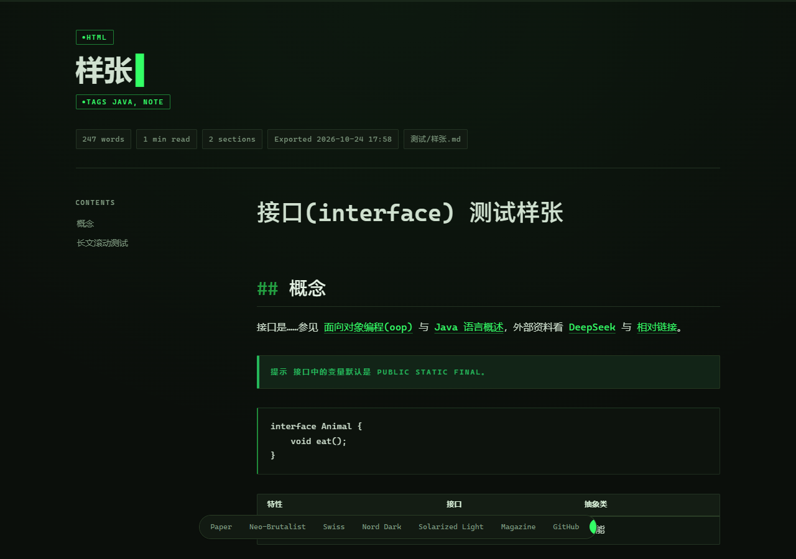

# Typeset Live

> 笔记的网页效果，开一个标签页就能看——不用离开 Obsidian。

一个 Obsidian 插件。写作的时候，当前笔记随时以排版精致的网页形式出现在 Obsidian 的标签页里：
8 套主题一键换装、跟随编辑实时刷新、内链即点即达。不导出文件、不打开浏览器，**所见即所得**。


---

## 它解决什么问题

把笔记渲染成好看的网页，[Typeset](https://github.com/Fogecode/Typeset) 已经做得很好——
但它会把你送去浏览器：导出、切窗口、回来改、再导出，写作节奏被反复打断。

Typeset Live 把同一套渲染搬进了 Obsidian：**左边写，右边看**。
切到哪篇笔记，预览就跟着渲染哪篇；每敲几百字，页面安静地重排一次——滚动位置都不带丢的。

---

## 三步上手

1. 安装并启用（见下方「安装」）
2. 点左侧功能区的地球图标，或命令面板运行 **「打开当前笔记的网页预览」**
3. 预览出现在新标签页——拖去侧边栏和笔记并排，或者留在当前页，随你

写完想分享出去？配套的 Typeset 一键导出独立 HTML 文件，两个插件各司其职。

---

## 功能

- **标签页预览**：渲染结果显示在 Obsidian 标签页里，可拖拽分栏，和普通笔记并排
- **8 套主题**：Paper / Neo-Brutalist / Swiss / Nord Dark / Solarized / Magazine / GitHub / Terminal，工具栏即时切换，页面配色渐变过渡、气泡滑块平滑到位
- **自动隐藏的主题条**：鼠标靠近页面顶部自动滑出，离开自动收起，不挡内容
- **跟随当前笔记**：切到哪篇，预览自动跟到哪篇（可关）
- **编辑实时刷新**：改笔记约 0.6 秒后自动重渲染，保持滚动位置（可关）
- **内链跳转**：预览里点双链或相对 .md 链接，直接在 Obsidian 打开对应笔记；外链走系统浏览器
- **代码复制**：复制按钮经 Obsidian 剪贴板，随时可用
- **手机宽度模拟**：一键收窄到 390px，检查响应式排版

### 主题速览




---

## 安装

### 手动安装

1. 下载本仓库（Code → Download ZIP 或 git clone）
2. 把仓库根目录的 main.js、manifest.json、styles.css、versions.json 放进
   你的仓库 `.obsidian/plugins/typeset-live/` 文件夹（没有就新建）
3. 重启 Obsidian，设置 → 第三方插件 → 开启 **Typeset Live**

### 从源码构建

```bash
npm install
npm run build   # 产出 main.js
```

---

## 与 Typeset 的关系

姊妹插件，同一套渲染管线：**Typeset Live 负责原地预览，Typeset 负责导出文件**。
两者互不依赖，可以只装一个，也可以同时安装。
[Typeset](https://github.com/Fogecode/Typeset) 仓库暂时归档（后续仍会更新），导出功能完整可用。

## 兼容与隐私

- Obsidian >= 1.4.0，桌面端与移动端均可用
- 渲染全程本地进行，**零网络请求**；预览运行在沙箱 iframe 里，与宿主的全部交互经显式消息通道，不碰笔记以外的任何东西

## 开发

```bash
npm run typecheck   # tsc --noEmit
npm run build       # main.js + data/test-bundle.cjs（验证用，gitignored）
```

`scripts/` 是验证工具链（本机自测用，依赖本地 Obsidian 仓库与 Chrome）：
mock-obsidian 离线加载模拟、verify-plugin / verify-bridge / verify-realnote
三套断言（23 + 26 + 9 项）、install-vault.ps1 一键装机（自动备份启用清单）。

## License

[MIT](LICENSE) · 第三方组件见 [THIRD-PARTY-NOTICES.md](THIRD-PARTY-NOTICES.md)
