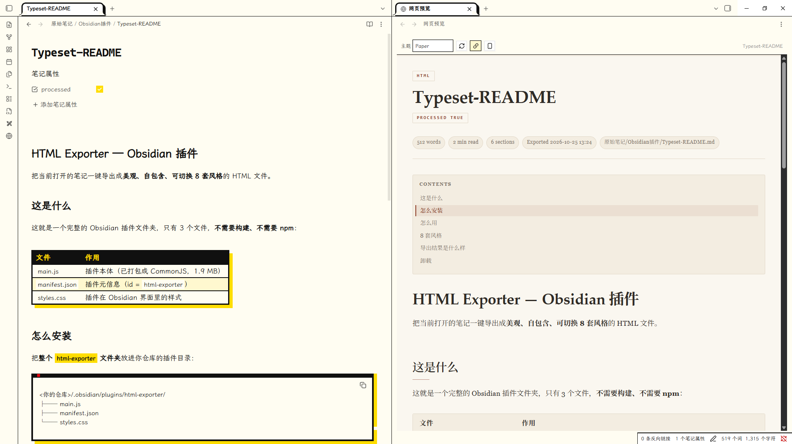
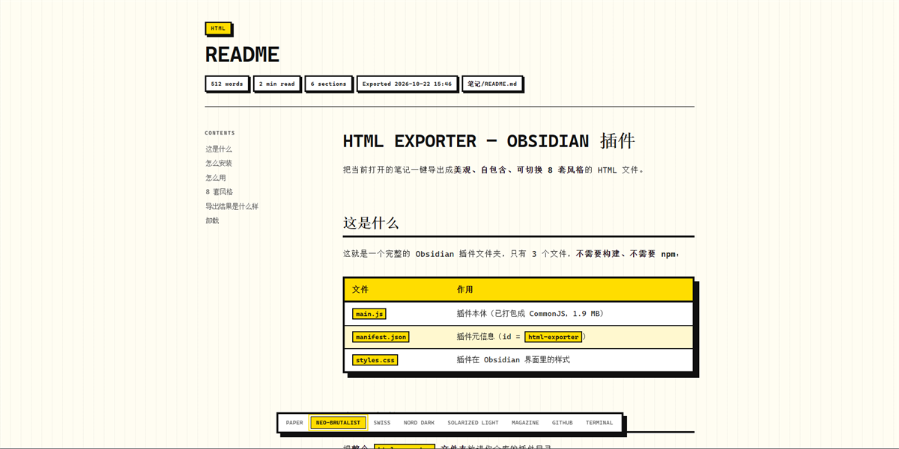
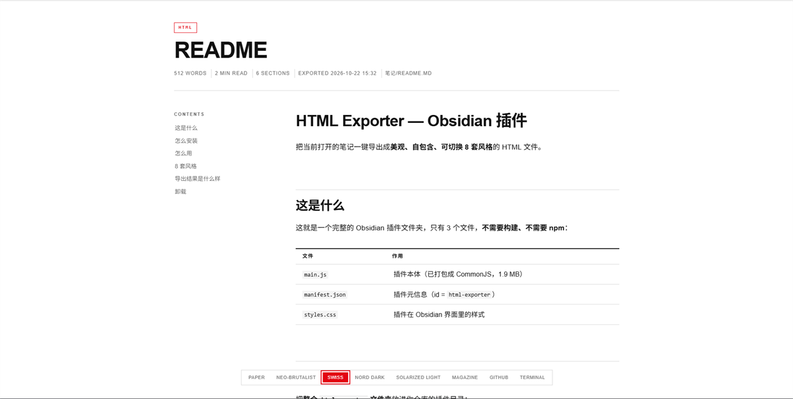
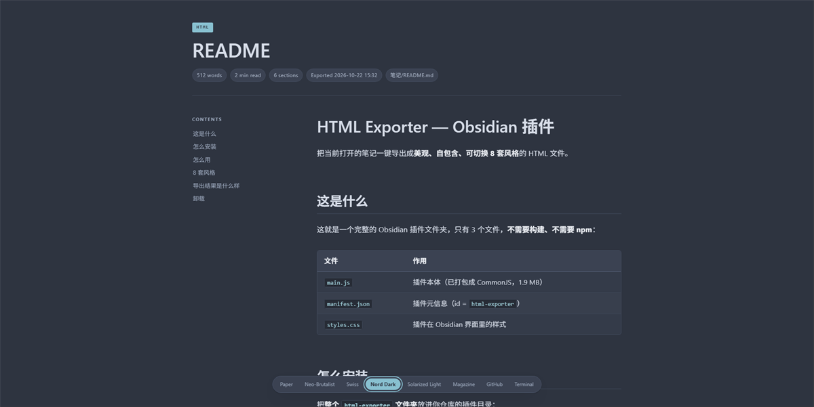
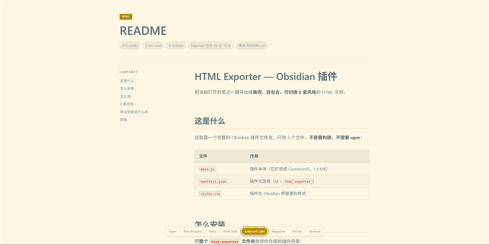
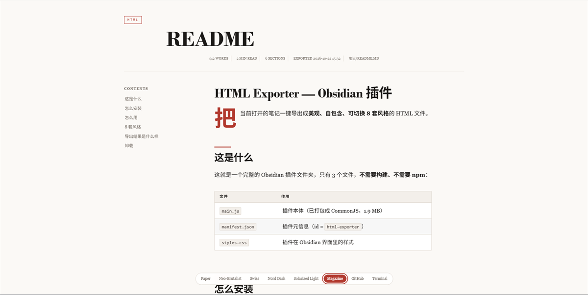
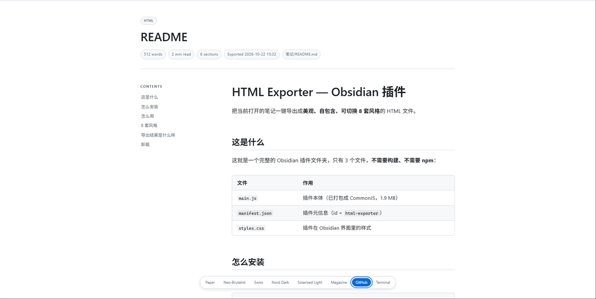
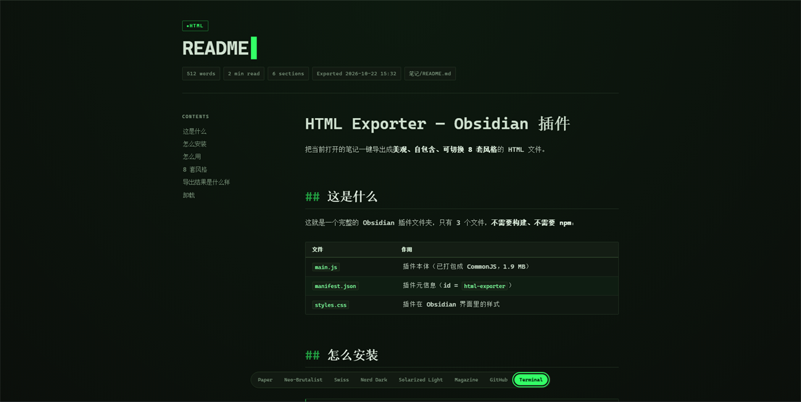

# Typeset
> **ℹ️ 姊妹项目 [Typeset Live](https://github.com/Fogecode/TypesetLive) 已上线**：同一套渲染引擎，但**不需要打开浏览器**——
> 网页渲染效果直接显示在 Obsidian 的标签页里，跟随编辑实时刷新、内链可直接跳转。
> 想在 Obsidian 内直接看渲染效果请移步新仓库；本仓（导出 HTML 文件）暂时归档，后续仍会更新。

> 把 Obsidian 笔记，变成一份好看的网页。

一个 Obsidian 插件。点一下按钮，当前笔记就会变成一份排版精致的独立 HTML 文件——
单文件、可离线、随手能发给别人。



---

## 它解决什么问题

用 Obsidian 写完东西，常常想分享出去。但导出的 PDF 排版呆板，复制到公众号又丢格式，
发 Markdown 原文对方多半看不懂。

Typeset 的做法很直接：**把你正在看的那篇笔记，整篇变成一个网页**。
打开就是成品，不需要对方装任何东西。

---

## 八种样子

同一篇笔记，换一种风格就是另一种气质。导出页右下角可以随时切换，
选过的会被记住，下次打开还是你喜欢的那一套。

### Paper · 暖纸衬线

米白纸面、衬线标题，像一本排版讲究的旧书。


### Neo-Brutalist · 新野兽派

粗黑边框、硬边投影、荧光黄。强烈的、不加修饰的视觉。



### Swiss · 瑞士国际主义

大量留白、细红线、克制的字距。冷静、理性、干净。



### Nord Dark · 冷调暗色

深蓝灰底，长时间阅读不刺眼。



### Solarized · 经典浅色

那套被无数编辑器采用的经典配色。



### Magazine · 杂志

大号衬线标题、首字下沉、居中引言，像翻开一页杂志。



### GitHub · 熟悉的样子

如果你常看 README，这套会让你觉得亲切。



### Terminal · 终端

绿字黑底，带提示符和光标。给喜欢命令行的人。



---

## 几个细节

**导出的是一个文件。**
CSS 和 JS 都写在里面，图片转成 base64，不引用任何外部资源。
断网能看，换电脑能看，十年后大概也还能看。

**内容不会丢。**
双链、图片、标注块、表格、代码高亮、任务列表、笔记属性——
原文档里有的，导出的页面里都在。

**手机上也能读。**
窄屏会自动收成单栏，目录挪到正文上方，不会挤成一团。

**想打印也考虑过了。**
打印时会自动隐藏按钮和目录，转成白底黑字。

**顺手加的小功能。**
目录导航、阅读进度条、代码块一键复制、回到顶部。
都在导出页里，不用额外装什么。

---

## 安装

把这三个文件放进仓库的插件目录：

```
<你的仓库>/.obsidian/plugins/typeset/
├── main.js
├── manifest.json
└── styles.css
```

然后在 **设置 → 第三方插件** 里打开 **Typeset**。
如果列表里没出现，重载一次 Obsidian（`Ctrl+P` → `Reload app without saving`）。

---

## 使用

| 想做的事 | 怎么做 |
| --- | --- |
| 直接导出 | 点左侧边栏的 `</>` 图标 |
| 用命令 | `Ctrl+P` → `Export active note to styled HTML` |
| 先选风格 | `Ctrl+P` → `Export active note with theme…` |

导出完成后会提示文件保存在哪。默认放在笔记旁边，可以在设置里改。

---

## 可调的地方

设置页里可以改默认风格、输出目录、导出后是打开浏览器还是弹窗预览，
也可以关掉图片内嵌、目录、进度条这些功能——如果你只想要最干净的样子。

---

## 最后

这个插件是我自己用着不方便，才动手写的。功能不算多，代码也谈不上精巧，
但每一个主题都是认真调过的，导出结果我自己会愿意发出去。

它远谈不上完美。如果你用着觉得哪里别扭、或者想要某种风格，
欢迎提 issue 告诉我——**能被真实使用反馈修正的东西，才有机会变好**。

如果说它看起来还算顺眼，那是因为站在了别人的肩膀上。

---

## 参考与致谢

插件的排版思路与视觉语言，大量借鉴了下面两个项目。
主题配色、间距、字体处理，很多地方都能看到它们的影子：

- **[UI](https://luckymaomi.github.io/ui/)** — 中文 UI 风格与设计规则资料库
- **[Style Atlas](https://weepwood.github.io/style-atlas/)** — 可交互的前端视觉风格图鉴

八套风格里的 Neo-Brutalist，其边框粗细、投影位移与强调色，
直接参照了 UI 项目给出的规格；Solarized、GitHub、Swiss 等风格，
也都能在 Style Atlas 里找到对应的原型。

Markdown 解析使用 [marked](https://github.com/markedjs/marked)，
代码高亮使用 [highlight.js](https://github.com/highlightjs/highlight.js)。

---

## 许可

[MIT](LICENSE) · 打包的第三方库声明见 [THIRD-PARTY-NOTICES.md](THIRD-PARTY-NOTICES.md)